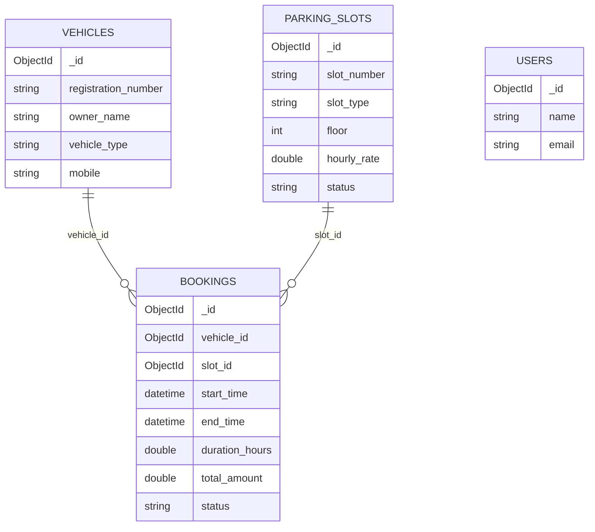

# Smart Parking Management System — CCE5 Report

## 1. Abstract

The Smart Parking Management System is a web application that organizes parking slots, registered vehicles and time-based reservations in a MongoDB database. The project addresses the difficulty of tracking parking capacity and preventing conflicting reservations with disconnected or manual records. A Flask backend exposes modular endpoints through blueprints, while a responsive Bootstrap interface presents a dashboard, forms, searchable tables and revenue visualization. PyMongo stores vehicle, slot and booking documents using ObjectId references and indexes. Booking validation checks vehicle and slot compatibility, positive time intervals, calculated duration and charges, and overlap with other confirmed or active bookings. The dashboard derives counts and completed-booking revenue from database records. MongoDB aggregation examples report booking statuses, utilization over a specified period, revenue by slot and duration statistics. Initialization and repeat-safe sample-data scripts prepare a local Community Server database. The application also includes documented API procedures, CRUD commands, indexing examples and test cases. Database tests and screenshots must be captured against a running local MongoDB instance; this deliverable does not claim results that were not executed.

## 2. Problem Statement

Manual parking records make it difficult to know current capacity, identify a vehicle's reservation, calculate charges consistently and prevent two customers from reserving the same space at overlapping times. The project provides a centralized database-backed application to manage these records and expose current parking information.

## 3. Objectives

- Store vehicles, slots and booking history in MongoDB.
- Provide CRUD workflows and search/filter tools through a browser interface.
- Reject duplicate registrations and overlapping slot reservations.
- Calculate durations, charges and dashboard analytics from stored records.
- Demonstrate MongoDB indexes, CRUD operations and aggregation pipelines.

## 4. Introduction to MongoDB

MongoDB is a document database that stores BSON documents in collections. Its flexible documents are suited to application records such as bookings, while ObjectId fields connect booking documents to vehicle and slot records. Indexes support fast lookups and enforce uniqueness. Aggregation pipelines transform matching documents into grouped summaries. This project uses MongoDB Community Server locally through PyMongo and can be inspected with MongoDB Compass.

## 5. System Requirements

Python 3.10+, Flask, PyMongo, MongoDB Community Server on localhost port 27017, and a modern browser. Bootstrap 5 and Chart.js load from CDN. Setup and launch steps are in the project README.

## 6. Database Design

Collections: `vehicles`, `parking_slots`, `bookings`, and `users` (reserved for future authentication). Vehicle and slot documents have their own ObjectId `_id`; bookings reference both using `vehicle_id` and `slot_id` and retain searchable `vehicle_number` and `slot_number` snapshots. A Mermaid overview:

Sample documents, CRUD queries and index commands are included in `mongodb_queries.md`.

## 7. Implementation of CRUD Operations

Vehicle and slot endpoints support create, list/filter, update and guarded delete. Booking endpoints create and update reservations, list/search booking history, and transition status to active, completed or cancelled. Inserts use `insert_one`/`insert_many`, reads use `find`/`find_one`, updates use `update_one`/`$set`, and deletion uses `delete_one`; the query reference demonstrates `update_many`, `$inc`, and `delete_many` as well.

## 8. Implementation of Indexing

Initialization creates a unique registration-number index, a single-field mobile lookup index and compound booking indexes for vehicle history and slot conflict searches. Slot numbers are also unique. Commands and `getIndexes()`/`explain("executionStats")` examples are in `mongodb_queries.md`.

## 9. Implementation of Aggregation Framework

The application provides live status counts, completed revenue, revenue by slot and average/minimum/maximum duration. The report also documents a date-bounded `$lookup` utilization pipeline: occupied booking-hours divided by available non-maintenance slot-hours. See `aggregation_queries.md` for the pipelines, definitions and illustrative output shapes.

## 10. Test Cases and Results

Twelve test procedures cover registration, duplicate handling, search, update/delete, slot creation, booking creation/update/cancellation, overlap rejection, availability and indexes/aggregations. The expected outcomes are documented in `test_cases.md`. At authoring time the local MongoDB port was unreachable, so tests remain unexecuted and no actual result is claimed. Run them and record observed outcomes before submission.

## 11. Screenshots of Implementation

Capture genuine screenshots after starting MongoDB and Flask: dashboard with seeded data, vehicle list, slot list, booking history, booking form/charge estimate, and MongoDB Compass showing the four collections and sample records. Screenshots are intentionally not fabricated.

## 12. Conclusion

The project provides a modular web interface and MongoDB data model for parking inventory, vehicle records and time-based bookings. Server-side checks calculate booking charges and prevent overlapping reservations, while indexes support common lookups and aggregation pipelines produce useful summaries. The scripts and documentation give a repeatable local setup suitable for a DBMS mini project. The current deliverable is structured for execution with MongoDB Community Server and Compass; database-backed testing and implementation screenshots should be completed on the student's machine after MongoDB is started. The included test table separates expected behavior from observed results so the report can accurately represent the final verification.

## 13. References

- MongoDB Manual: https://www.mongodb.com/docs/manual/
- PyMongo documentation: https://pymongo.readthedocs.io/
- Flask documentation: https://flask.palletsprojects.com/
- Bootstrap documentation: https://getbootstrap.com/docs/5.3/
- Chart.js documentation: https://www.chartjs.org/docs/latest/
